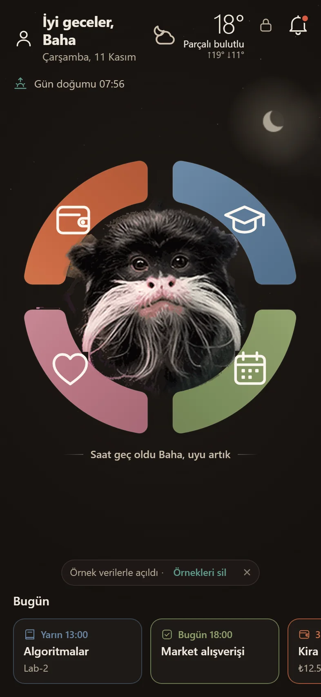

# Tamarin

iPhone için kişisel günlük asistan. Safari'den ana ekrana eklenen, internete ihtiyaç duymadan çalışan bir
web uygulaması (PWA). Ödemeleri, ders programını, sınavları, doğum günlerini ve yapılacak işleri tek bir
"yüz"de toplar; ortadaki tamarin günün durumuna göre konuşur.

**Adres:** https://mustafabahafaik.github.io/tamarin/

<p align="center">
  
</p>

## Özellikler

- **Ana ekran:** saate göre selamlama, hava durumu ve 4 günlük tahmin, dört dilimli halka (Ödemeler,
  Eğitim, Özel Günler, Ajanda), acil bir şey varsa çalan zil ve "Bugün" kartları. Arka planda havaya göre
  yağmur, kar, güneş ışını gibi hafif efektler.
- **Ödemeler:** kira, aidat, faturalar ve abonelikler; aylık özet, vade ve gecikme etiketleri, tek dokunuşla
  "ödendi".
- **Eğitim:** ders programı ("Şimdi" ve "Sıradaki" ders, boşluklar, çakışma uyarısı) ve sınav geri sayımı.
- **Özel Günler:** doğum günleri ve yıldönümleri; yaş / yıl hesabı, doğum günü kutlama kartı, 29 Şubat desteği.
- **Ajanda:** "yarın 14:00 dişçi" gibi Türkçe yazıdan tarih ve saati anlayan hızlı ekleme, gruplu liste,
  kaydırarak silme ve erteleme.
- **Şifre kasası:** uygulama şifreleri için ana şifreyle açılan, şifreli bir kasa.
- **Telefonlar:** telefonlar, hatları ve SIM PIN'leri tek yerde; her telefon modeline ve kılıf rengine göre
  çizilir. PIN listede görünmez, istenince kısa süre gösterilir ve kopyalanınca panodan silinir.
- **Takvime aktarma:** kayıtları iPhone Takvimi'ne `.ics` olarak gönderir; hatırlatmaları Takvim verir.
- **Yedek:** tüm kayıtlar tek bir JSON dosyasına alınır ve geri yüklenir.

## iPhone'a kurulum

1. iPhone'da **Safari** ile https://mustafabahafaik.github.io/tamarin/ adresini aç.
2. Alttaki **Paylaş** düğmesine dokun.
3. **Ana Ekrana Ekle**'yi seç ve **Ekle**'ye dokun.

Tamarin artık ana ekranda kendi simgesiyle, tam ekran açılır. İlk açılışta örnek kayıtlar gelir; yüzdeki
"Örnekleri sil" ile temizlenebilir.

## Bildirimler

Tamarin bildirim göndermez; hatırlatmaları iPhone'un kendi **Takvim** uygulaması verir.

1. Tamarin'de **Ayarlar > Takvim > Tümünü takvime aktar**'a dokun (ya da bir kaydın formundaki
   **Takvime ekle**'ye).
2. Açılan ekranda etkinlikleri **kendi takvimine** ekle ("Tamarin" adlı yeni bir takvime değil).
3. iPhone **Ayarlar > Takvim > Bildirimler** açık olmalı.

Aynı kaydı iki kez aktarırsan takvimde iki kez görünebilir. Değiştirdiğin bir kaydı yeniden aktarmadan
önce takvimdeki eskisini sil. **Sadece yeni ve değişenleri aktar** yalnızca hiç aktarılmamış ya da sonradan
değişmiş kayıtları gönderir.

## Gizlilik ve güvenlik

- **Veriler yalnızca cihazında durur.** Sunucu, hesap ya da senkronizasyon yok; her şey tarayıcının yerel
  deposunda (localStorage) tutulur. Safari'nin site verilerini silmek kayıtları da siler, bu yüzden ara
  sıra **Ayarlar > Yedek al** iyi olur.
- Hava durumu için yalnızca seçilen şehrin koordinatları [Open-Meteo](https://open-meteo.com/)'ya gönderilir.
- **Şifre kasası** tarayıcının Web Crypto API'siyle şifrelenir: ana şifreden PBKDF2-SHA256 (600.000
  tekrar, rastgele salt) ile anahtar türetilir, kayıtlar **AES-GCM 256** ile şifrelenir. Ana şifre ve
  şifrelerin düz hali hiçbir yere yazılmaz; kasa ana yedeğe girmez ve uygulama arka plana geçince kilitlenir.
  Ana şifreyi unutursan kasadaki şifreler kurtarılamaz.
- **SIM PIN'leri** (Telefonlar) kasa gibi şifrelenmez: diğer kayıtlarla birlikte cihazın yerel deposunda
  durur ve yedek dosyasına girer. Yedek dosyasını güvenli bir yerde sakla.

## Geliştirme

Framework ve derleme adımı yok: saf HTML, CSS ve JavaScript modülleri.

```bash
node tools/serve.mjs          # http://localhost:5190/tamarin/  (telefondan bakmak için --lan)
node tests/vault.test.mjs     # diğerleri: bills, school, days, tasks, ics, phones
```

## Görseller

Tamarin görseli ve ondan üretilen uygulama simgeleri (`assets/`, `icons/`) bu projenin sahibine aittir.
